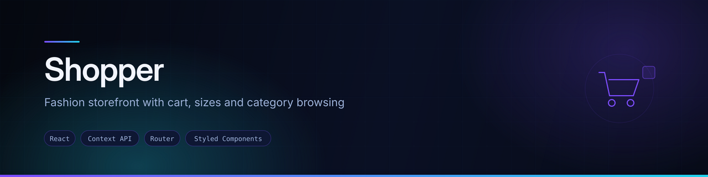
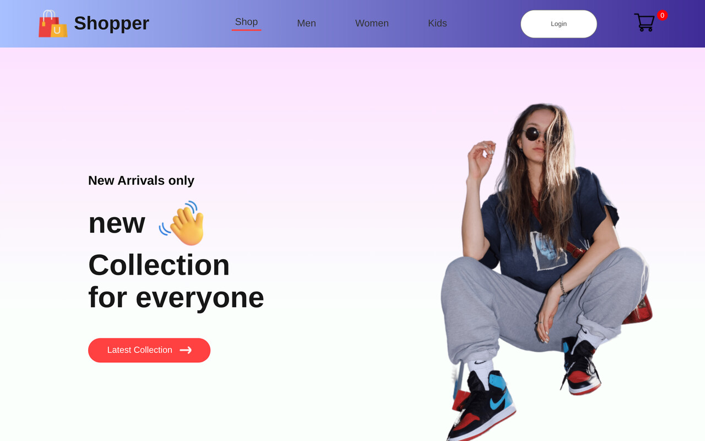

<div align="center">
  
</div>

<div align="center">


</div>

## Overview

**Shopper** is a fashion storefront — new arrivals, popular items, three shopping categories and a working cart. A compact build focused on getting cart mechanics right rather than on breadth of features.

## Preview



<sub>Screenshot captured from a local production build of this repository.</sub>

## Features

- **Three categories** — Men, Women, Kids — each on its own route
- **Product detail route** (`/product/:productId`)
- **Working cart** with add, remove, running item count and order total, all computed in a Context provider:
  - `addToCart` / `removeFromCart`
  - `getTotalCartItems` — the badge in the header
  - `getTotalCartAmount` — the order summary
- **Landing sections** — hero, new collection, popular items, offers, newsletter
- **Login route** as an entry point

## Tech stack

| Layer | Technology |
|---|---|
| Framework | React (Create React App) |
| Routing | React Router DOM — 8 routes |
| State | React Context (`ShopContext`) — no Redux despite the dependency list |
| Styling | Styled Components and hand-written CSS |

## Project structure

```
src/
├── Components/      Navbar, Hero, Popular, NewCollections,
│                    Offers, NewsLetter, Item, Footer, CartItems
├── Pages/           Shop, ShopCategory, Product, Cart, LoginSignup
├── Context/
│   └── ShopContext.jsx   Cart state, totals, product list
└── App.js           8 route definitions
```

## Running locally

```bash
git clone https://github.com/AJAY2043/shopper-react.git
cd shopper-react
npm install
npm start
```

```bash
npm run build     # production build into ./build
```

## What this is, honestly

A **front-end learning build**. The cart maths is real and works; everything behind it is not:

- Products are a bundled array, not a catalogue service
- No checkout, payment or orders
- Login is a form with no authentication behind it
- `redux`, `react-redux`, `@reduxjs/toolkit`, `react-query`, `axios` and `formik` are declared in `package.json` but never imported

## Future improvements

- Persist the cart to `localStorage` so it survives a reload
- Add size and quantity selection on the product page
- Add a checkout flow and an order summary step
- Fetch products from an API — the `axios` and `react-query` dependencies were presumably added for this
- Remove the unused dependencies until they are actually needed

## Author

**Ajay Krishna Reddy Bhavanam** — Melbourne, Australia
[LinkedIn](https://linkedin.com/in/ajay-krishna-reddy) · [GitHub](https://github.com/AJAY2043)
